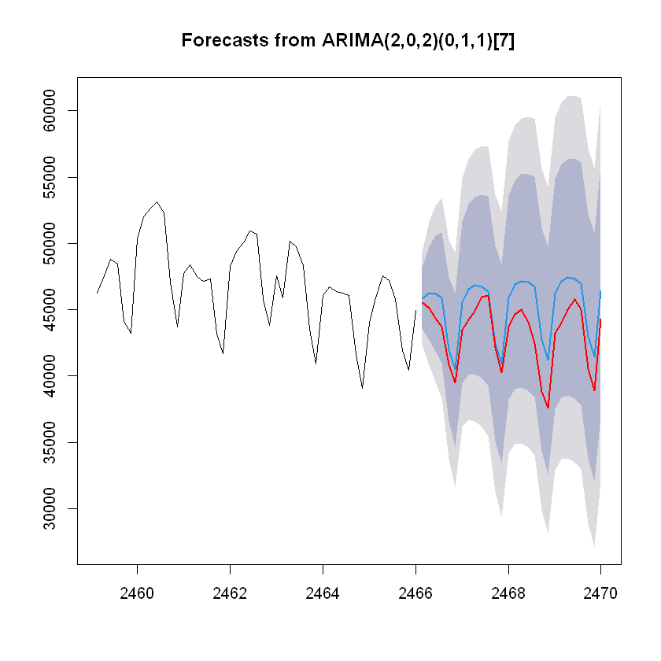

# Prévision de la consommation électrique nationale (Données RTE)

Modélisation et prévision à court terme de la demande électrique française journalière selon la méthodologie **Box-Jenkins (SARIMA)** sous **R**, accompagnée d'un tableau de bord interactif **Power BI**.

---

##  Objectif du projet
Anticiper la courbe de charge électrique nationale sur un horizon opérationnel de **7 à 28 jours** en modélisant la saisonnalité hebdomadaire (alternance jours ouvrés / week-ends) observée sur le réseau de transport d'électricité français (**RTE**).

---

##  Données & Prétraitement
* **Source :** Open Data RTE (Réseau de Transport d'Électricité).
* **Périmètre :** ~3 000 observations journalières (2018 – 2026).
* **Qualité des données :** Gestion des passages à l'heure d'été et d'hiver (agrégation des doublons d'octobre et interpolation linéaire des créneaux manquants de mars pour garantir 48 demi-heures exactes par jour).

---

##  Méthodologie (Approche Box-Jenkins)

1. **Analyse exploratoire & Stationnarisation :**
   * Identification d'une forte saisonnalité hebdomadaire (`s = 7`) avec une baisse marquée de la consommation le samedi et le dimanche.
   * Application d'une différenciation saisonnière (`D = 1`, période `7`) pour stabiliser la série.

2. **Sélection du modèle :**
   * Comparaison par grille de recherche (*grid search*) selon le critère **AIC** croisée avec `auto.arima`.
   * **Modèle retenu : `SARIMA(2, 0, 2)(0, 1, 1)`** (préféré à `(2, 0, 2)(1, 1, 1)` par principe de parcimonie, l'écart d'AIC n'étant que de `0,32` point).

3. **Diagnostic des résidus :**
   * **Tests statistiques :** Ljung-Box (`p = 5.23e-10`) et Shapiro-Wilk (`W = 0.912`, `p < 2.2e-16`).
   * **Interprétation critique :** Les résidus sont centrés en zéro et sans autocorrélation majeure (< 7 %). Les queues épaisses observées sur le *Q-Q Plot* reflètent les aléas météorologiques ponctuels (vagues de froid, canicules) et jours fériés non capturés par un modèle univarié à période 7.

---

##  Résultats & Validation (Train / Test chronologique)

Afin d'éviter toute fuite de données (*data leakage*), un découpage strictement chronologique a été appliqué pour évaluer le modèle sur deux horizons :

| Horizon de test | MAPE *(Erreur %)* | MAE *(MW)* | RMSE *(MW)* | MASE *(vs naïf J-7)* | Theil's U *(vs naïf J-1)* |
| :--- | :---: | :---: | :---: | :---: | :---: |
| **Apprentissage (Train)** | `2,17 %` | `1 147 MW` | `1 774 MW` | `0,34` | — |
| **Test à 7 jours (`J+7`)** | **`0,89 %`** | **`398 MW`** | **`519 MW`** | **`0,12`** | **`0,16`** |
| **Test à 28 jours (`J+28`)** | **`4,74 %`** | **`2 021 MW`** | **`2 275 MW`** | **`0,59`** | **`0,90`** |

### Points clés à retenir :
* **Haute précision à court terme (`J+7`) :** Erreur moyenne inférieure à **1 %** (`99,1 %` de précision) et réduction de **88 % de l'erreur** par rapport à une prévision saisonnière naïve (`MASE = 0,12`).
* **Cadrage opérationnel (`J+28`) :** L'erreur augmente progressivement jusqu'à `4,74 %` à 4 semaines en raison des évolutions saisonnières de long terme, confirmant l'usage optimal du modèle pour du **pilotage hebdomadaire**.

---

##  Aperçu des résultats visuels

### Prévision SARIMA vs Réalité (Échantillon Test - 28 jours)

---

##  Pistes d'amélioration (Mise en production)
* **Modélisation multivariée (`SARIMAX`) :** Intégration de la **température** (thermosensibilité du réseau français) et du **calendrier des jours fériés** comme variables exogènes.
* **Double saisonnalité :** Ajout de **termes de Fourier** pour capturer simultanément le cycle hebdomadaire (`s = 7`) et le cycle annuel (`s = 365,25`).
* **Validation robuste :** Évaluation par validation croisée glissante (*rolling window*).

---

##  Stack technique
* **Analyse & Modélisation :** R (`forecast`, `tseries`, `dplyr`, `lubridate`)
* **Data Visualization & BI :** Power BI Desktop (DAX, Power Query)
